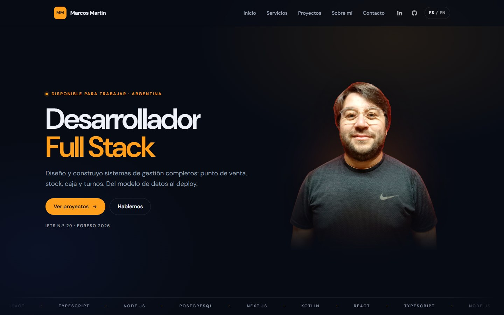

# Portfolio — Marcos Martin

Sitio personal de Marcos Martin, desarrollador full stack. Un solo scroll con presentación, servicios, proyectos y contacto, en español e inglés.



## Stack

- React 18 + Vite 4
- Framer Motion para las transiciones y el parallax
- SCSS con tokens de color y tipografía
- EmailJS para el formulario de contacto
- DM Sans (Google Fonts)

## Estructura

```
portfolioAnimado/
├── public/            # imágenes y favicon
└── src/
    ├── components/    # navbar, hero, servicios, proyectos, about, contacto, footer
    ├── context/       # provider de idioma ES/EN
    ├── content.js     # todos los textos en español e inglés
    ├── app.scss       # estilos globales y utilidades
    └── App.jsx
```

## Desarrollo

```bash
cd portfolioAnimado
npm install
npm run dev
```

Disponible en `http://localhost:5173`.

## Build

```bash
cd portfolioAnimado
npm run build
npm run preview
```

## Variables de entorno

El formulario usa EmailJS. Copiá `portfolioAnimado/.env.example` a `portfolioAnimado/.env.local` y completá las claves si querés usar tu propia cuenta:

```
VITE_EMAILJS_SERVICE_ID=
VITE_EMAILJS_TEMPLATE_ID=
VITE_EMAILJS_PUBLIC_KEY=
```

Sin variables definidas, el sitio usa la configuración pública por defecto del proyecto.

## Deploy

El sitio se publica en Vercel desde este repositorio con **Root Directory** `portfolioAnimado`, build `npm run build` y output `dist`. El dominio es [martinmarcos.net.ar](https://www.martinmarcos.net.ar/).

## Licencia

© Marcos Martin. Todos los derechos reservados.
